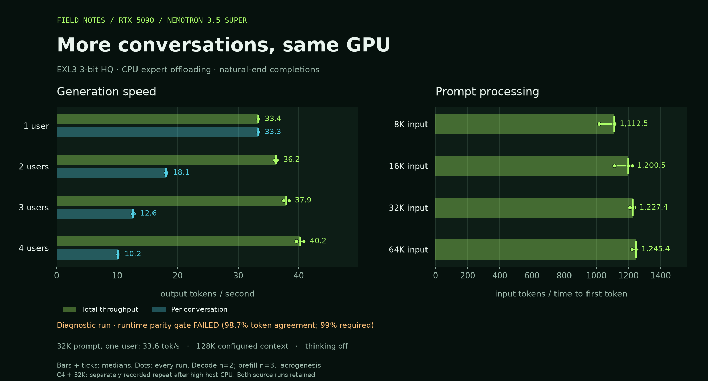

# Nemotron 3.5 Super recipe kit

Run the text component of Nemotron 3.5 Super 120B-A12B EXL3 on an RTX 5090 with CPU expert offloading, then measure it with a Nemotron adaptation of [Sybil's recipe protocol](https://github.com/sybil-solutions/local-ai-recipe-kit).

This kit uses **ExLlamaV3 with the included architecture patch**. It includes a small streaming API server, an independent reference-panel builder, quality checks, a long-context retrieval check, concurrent speed tests and memory/power measurements. It does not enable vision or MTP.

The target is a 32 GB RTX 5090, Ryzen 9950X3D and 128 GB RAM. The 50 GB weight files use VRAM plus RAM. [Exact settings](targets/nemotron35-super-exl3.md) · [Measurement protocol and adaptations](PROTOCOL.md).

## RTX 5090 measurements

**Diagnostic results: runtime parity failed.** The speed configuration matched 296/300 reference tokens (98.67%), with mean top-20 KL 0.001659. The gates require at least 99% agreement and KL at most 0.001. [All precision experiments](results/2026-10-15-rtx5090/diagnostics/) are retained.



| Load | Total output tok/s | Per-user tok/s |
|---|---:|---:|
| 1 user | 33.36 | 33.34 |
| 2 users | 36.25 | 18.12 |
| 3 users | 37.95 | 12.65 |
| 4 users | 40.25 | 10.15 |
| 1 user, 32K prompt | 33.64 | — |

Medians of two natural-end rounds; no output cap. C4 and 32K values come from the targeted repeat after a host-CPU load burst; the other loads come from the initial full sweep. Same 3-bit HQ EXL3 model, thinking off, 128K total cache, CPU expert offloading. The 119,983-token retrieval check passed. These are HTTP measurements from the adapted Sybil protocol, using ExLlamaV3 rather than Sybil's model-specific SGLang runtime. [Raw results, memory measurements and validation](results/2026-10-15-rtx5090/).

## Build and download

Use Linux, Podman with NVIDIA CDI configured, Python 3 and the Hugging Face CLI. The image builds CUDA kernels for SM120. The base image and engine source are pinned; the container is built locally, not downloaded from an unpublished image tag.

```bash
hf download acrogenesis/NVIDIA-Nemotron-3.5-Super-VL-120B-A12B-EXL3-3bpw \
  --revision 8cff1e817bd8f0a29d57b3f5ed5b89163670ff68 --local-dir ./models/nemotron35
timeout 3600 podman build --memory 16g -t localhost/nemotron35-recipe-kit:local .
```

## Serve

```bash
mkdir -p work/server
timeout 30 podman run -d --name nemotron35-recipe \
  --device nvidia.com/gpu=all --security-opt label=disable \
  --memory 56g --memory-swap 56g --shm-size 4g --ulimit memlock=-1:-1 \
  -p 127.0.0.1:30080:30000 \
  -v "$PWD/models/nemotron35:/models:ro" -v "$PWD/work/server:/results:rw" \
  localhost/nemotron35-recipe-kit:local
```

Wait for `curl --max-time 5 http://127.0.0.1:30080/health` to return `ok`. The endpoint is `http://127.0.0.1:30080/v1`, model `nemotron35-exl3`. The host port is bound to loopback. The server supports text chat, streaming and greedy sampling; it is a benchmark/reference server, not a complete OpenAI API implementation. No output cap is applied when the client omits it; the 131,072-token context remains the hard bound.

`timeout 30 podman stop nemotron35-recipe` stops it.

## Repeat the measurements

Stop the model server before building the reference panel. The reference streams one complete layer at a time through the GPU; the speed server uses CPU experts. The same quantized weights are compared in both paths.

```bash
timeout 1800 podman run --rm --device nvidia.com/gpu=all --security-opt label=disable \
  --memory 16g --memory-swap 16g --shm-size 4g \
  -v "$PWD/models/nemotron35:/models:ro" -v "$PWD/reference:/reference:rw" \
  --entrypoint python localhost/nemotron35-recipe-kit:local \
  /kit/tools/build_reference.py --model /models --out /reference/nemotron35-exl3.json
```

Before launching the server, record the hardware and bandwidth, then start memory logging in a separate terminal:

```bash
mkdir -p work
python tools/probe.py --models-dir ./models/nemotron35 --out work/probe.json
timeout 600 podman run --rm --device nvidia.com/gpu=all --security-opt label=disable \
  --memory 16g --memory-swap 16g --entrypoint python \
  localhost/nemotron35-recipe-kit:local /kit/tools/hw_bw.py > work/bandwidth.json
bash tools/memwatch.sh work/memwatch.csv
```

Create the server with the Serve command, or use `podman start nemotron35-recipe` if it already exists. After it is healthy, reproduce the published diagnostic campaign:

```bash
python tools/record_launch.py --image localhost/nemotron35-recipe-kit:local --out work/launch.json
python tools/smoke.py
python tools/run_campaign.py --diagnostic --out work/campaign \
  --config 'Nemotron EXL3; RTX5090; CPU320/threads8; batch4; ctx131072; chunk2048; CPU_WIDE=1; INT8=0; swap=0'
```

Omit `--diagnostic` to require passing parity and retrieval gates before speed testing. The published run uses diagnostic mode because parity failed; its state remains `complete_diagnostic` and retains the failed scores. Stop the memory logger after the campaign. Decode requests run to EOS, so the complete sweep takes longer than a capped microbenchmark. Do not run another model or a CPU/GPU build while measuring. The [protocol](PROTOCOL.md) explains the scoring thresholds, random-token adaptation, cache checks and remaining limits.

The campaign gate checks also run without a GPU: `python -m unittest discover -s tests -v`.

## Provenance

Weights: [Hugging Face release](https://huggingface.co/acrogenesis/NVIDIA-Nemotron-3.5-Super-VL-120B-A12B-EXL3-3bpw), freshly quantized from NVIDIA's BF16 release. The model card includes a separate BF16-versus-EXL3 quantization-loss measurement; runtime parity in this kit does not measure that loss again.

Engine: [ExLlamaV3](https://github.com/turboderp-org/exllamav3), revision `058b8630fd081f3ff46fce6246955b157c3a2e3b`, with the text-only Nemotron adapter and opt-in CPU activation precision patch in `patches/`. Benchmark tools are adapted from [Sybil's recipe kit](https://github.com/sybil-solutions/local-ai-recipe-kit) at `ef9782ce0c564be8162e34edcb6bb626f56901d3`. Original tool hashes, protocol and MIT notice are in `upstream/`. Source code uses the MIT license; model weights retain their own OpenMDW-1.1 license and are not included here.
