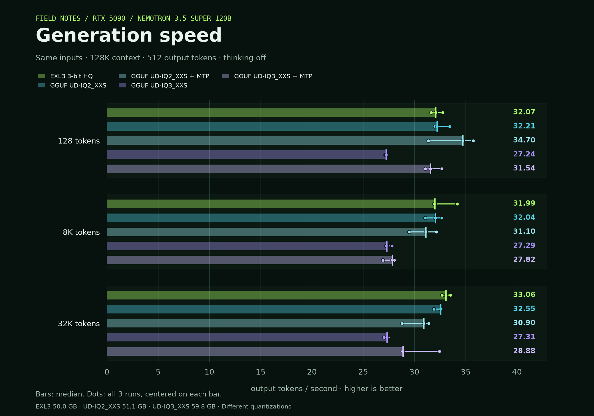

# Nemotron 3.5 Super: EXL3 versus Unsloth GGUF

RTX 5090 32 GB, Ryzen 9950X3D, 128 GB DDR5. Same text model family, identical token inputs, 128K configured context, FP16 KV cache, thinking off and greedy decoding. Each cell is the median of three 512-token responses from a single user.



| Runtime / quantization | 128-token prompt | 8K prompt | 32K prompt |
|---|---:|---:|---:|
| EXL3 3-bit HQ | 32.07 | 31.99 | 33.06 |
| Unsloth UD-IQ2_XXS | 32.21 | 32.04 | 32.55 |
| Unsloth UD-IQ2_XXS + MTP | 34.70 | 31.10 | 30.90 |
| Unsloth UD-IQ3_XXS | 27.24 | 27.29 | 27.31 |
| Unsloth UD-IQ3_XXS + MTP | 31.54 | 27.82 | 28.88 |

Output tokens per second, measured over HTTP from the first token to the final stream event: `(generated_tokens - 1) / elapsed`. The earlier kit sweep ran to natural EOS; its results use a different workload.

## Time to first token

| Runtime / quantization | 128-token prompt | 8K prompt | 32K prompt |
|---|---:|---:|---:|
| EXL3 3-bit HQ | 1.26 | 7.98 | 28.06 |
| Unsloth UD-IQ2_XXS | 1.16 | 5.99 | 24.25 |
| Unsloth UD-IQ2_XXS + MTP | 1.19 | 6.70 | 26.42 |
| Unsloth UD-IQ3_XXS | 1.43 | 7.52 | 29.37 |
| Unsloth UD-IQ3_XXS + MTP | 1.49 | 8.06 | 32.26 |

Seconds after sending the request. All reported requests processed their full input with zero prompt-cache hits and generated 512 tokens without context truncation.

## Weights and runtime

EXL3 3-bit HQ is **50.0 GB**. Unsloth **UD-IQ2_XXS is 51.1 GB**, the closest download size; **UD-IQ3_XXS is 59.8 GB**. These are different mixed-precision quantizations of the BF16 model family. Precision labels alone do not make them equivalent.

GGUF runs use Unsloth's CUDA 13 llama.cpp build **b11643-mix-cfaf026**, source `3bf0e05945af8821ef53d6daaf80d2fb4f234bd6`, directly through its HTTP server. Eight CPU threads, batch/ubatch 2048, one slot, automatic CPU/GPU placement, 2048 MiB GPU margin, and MoE expert cache disabled. MTP runs use the embedded prediction head with up to three draft tokens. Automatic placement may change to accommodate that head. Exact arguments are in the launch JSON files.

GGUF revision: `unsloth/NVIDIA-Nemotron-3.5-Super-VL-120B-A12B-GGUF@75a5829055f69a0359085ae6bbd0a81b60bc05c6`. All six shards passed SHA-256 verification. EXL3 uses the existing pinned recipe image and model, with CPU320/threads8 and MTP disabled. Its existing [quality measurements](../2026-10-15-rtx5090/#measured-quality) remain separate from this speed comparison.

## Repeats and resource checks

An unrelated host CPU burst affected the first IQ2 8K request. That exact case was repeated and used regardless of speed. The original and repeat are retained under `raw/`; the 8K median is unchanged. EXL3 was repeated at the end because background CPU use increased during the session; the final repeat supplies the table and graph, and the initial baseline is retained.

All model processes recorded zero swap use and zero OOM kills. GPU figures in [resources.json](resources.json) include the desktop and cover the measurement windows. Cgroup memory includes file cache, whose accounting can span service restarts; these totals are not whole-model RAM requirements. Host swap was already occupied and is distinct from model-process swap.

Native llama.cpp SSE events can combine text when a UTF-8 character spans tokens. An initial checker incorrectly required 512 streamed token IDs; the corrected check uses the server's authoritative generated count. Timings were unchanged. Each run retains the final metadata, responses and client event timestamps. [File provenance](analysis-provenance.json) records hashes before and after local-path redaction. [Summary data](summary.json) includes MTP draft acceptance counts.

## Reproduce

Use the included [fixture](fixture.json) with the benchmark client:

```bash
python tools/compare_gguf.py run --backend llama --url http://127.0.0.1:30081 \
  --label iq2-base --fixture results/2026-10-15-gguf/fixture.json --out run.json
```

The fixture preserves every input token ID, including the seeded random prefix used for long prompts. `--backend exl3` targets the recipe's `/generate` API; `llama` targets `/completion`. Check that each server exposes 131072 context before running. The `*-launch.json` files contain the pinned runtime and complete server arguments; replace local path placeholders with your model and CUDA-library paths.

Redraw the figure with `python tools/plot_gguf_comparison.py --results results/2026-10-15-gguf --out results/2026-10-15-gguf/throughput`.
